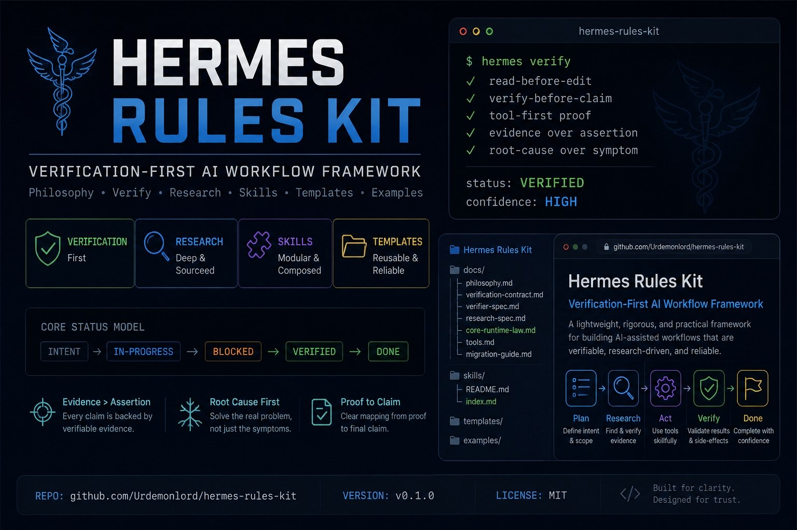

# Hermes Rules Kit

[](https://github.com/Urdemonlord/hermes-rules-kit/releases)
[](./LICENSE)
[](./ROADMAP.md)

Agent execution framework with a Hermes-native reference implementation for grounded coding, verification, research, and multimodal proof.

This is not a persona pack.
This is not motivational prompt fluff.
This is an execution framework for making Hermes more reliable under real tool use.



## What problem this solves

Most agent failures are not intelligence failures. They are operating-discipline failures:
- answering from prose when tools could settle the question
- editing before locating the owner of the behavior
- patching symptoms instead of broken invariants
- claiming success without runtime proof
- letting stale context pollute later decisions
- mixing assumptions across unrelated projects
- trusting side effects that were never directly verified

Hermes already has strong tools.
What it needs is a stricter contract for how those tools turn into action.

Hermes Rules Kit provides that contract.

## Positioning

This repo has two layers:
- **Execution framework core** — agent-agnostic rules about inspection, proof, status language, context hygiene, and root-cause debugging
- **Hermes-native adapter** — concrete tool mappings, templates, and modular skills built around the Hermes runtime

That split matters.
The core ideas should transfer to other agent runtimes.
The Hermes-specific pieces show one serious implementation target rather than pretending every tool stack behaves the same.

## What this repo contains

```text
hermes-rules-kit/
├── README.md
├── ROADMAP.md
├── CONTRIBUTING.md
├── assets/
│   ├── social-preview.svg
│   └── social-preview.png
├── docs/
│   ├── portability.md
│   ├── philosophy.md
│   ├── core-runtime-law.md
│   ├── architecture.md
│   ├── verification-contract.md
│   ├── hermes-tool-mapping.md
│   ├── verifier-spec.md
│   ├── research-spec.md
│   ├── swarm-mode.md
│   ├── migration-notes.md
│   └── releases/
│       ├── v0.1.1.md
│       └── v0.2.0.md
├── templates/
│   ├── AGENTS.template.md
│   ├── minimal-AGENTS.template.md
│   ├── swarm-AGENTS.overlay.md
│   ├── paste-into-your-agent.md
│   └── closeout-template.md
├── examples/
│   ├── debugging-closeout.md
│   ├── kanban-swarm-workflow.md
│   ├── failure-modes/
│   │   ├── README.md
│   │   ├── context-contamination-across-projects.md
│   │   ├── service-claimed-up-without-health-check.md
│   │   ├── stale-plan-after-tool-result.md
│   │   ├── symptom-patch-instead-of-invariant-owner.md
│   │   └── unverified-fixed-claim.md
│   ├── verification-closeout.md
│   ├── verifier-report.md
│   ├── research-report.md
│   └── project-agnostic-AGENTS.md
└── skills/
    ├── README.md
    ├── index.md
    ├── hermes-agentic-coding-20-80/
    ├── hermes-verifier-mode/
    ├── hermes-deep-research-loop/
    ├── hermes-multimodal-proof/
    ├── meow-orchestrator/
    ├── meow-researcher/
    ├── meow-builder/
    ├── meow-verifier/
    ├── meow-reviewer/
    └── meow-swarm-mode/
```

## Core ideas

### 1. Inspect before deciding
For non-trivial tasks:
1. define the outcome operationally
2. inspect repo, runtime, and constraints first
3. find the spine: entry points, data flow, state, persistence, user-visible surface
4. prove the smallest vertical slice
5. verify where the user experiences the result
6. expand only after proof

### 2. Reasoning must update after every tool result
Every tool result should change the next move.

Loop:
- observe
- update
- decide

Hard rules:
- explain surprising results before continuing
- do not keep executing a stale plan invalidated by new evidence

### 3. Root cause over symptom
Use this chain:
- symptom
- mechanism
- invariant
- breach
- fix

If the invariant still fails, the bug is not fixed.

### 4. Proof must match the claim
A build pass is not proof of user-visible behavior.
A code diff is not proof of runtime correctness.
A self-report from a subagent is not proof of side effects.

### 5. Context hygiene is a first-class concern
Long context is useful only if low-signal or stale material is compressed or dropped.

### 6. Project isolation is mandatory
Do not carry assumptions, conventions, or deployment habits from project A into project B just because they look similar.

## Quick start

Use Hermes Rules Kit in two ways:
- **Paste mode** — copy a compact rules block into your AI agent's system prompt, custom instructions, or agent file
- **Repo mode** — install a project-local `AGENTS.md` so the rules live with the codebase

### Option A: paste into your AI agent

Use this when you want the fastest possible adoption in ChatGPT, Claude, Cursor, Codex, or any agent that accepts custom instructions.

Copy the block from:
- `templates/paste-into-your-agent.md`

What this gives you:
- immediate improvement in agent discipline
- minimal setup friction
- model-agnostic adoption

### Option B: install into your repo

Use this when you want persistent, versioned behavior for one codebase.

Choose one template:
1. `templates/AGENTS.template.md` for the fuller default operating law
2. `templates/minimal-AGENTS.template.md` for a shorter starting point

Then:
3. Copy the chosen template to `AGENTS.md` in the target repo.
4. Edit only the project-specific sections.
5. Keep the universal law compact.
6. Put deeper workflow details in docs or modular skills, not in the always-on core.

Minimal shell example:

```bash
cp templates/minimal-AGENTS.template.md /path/to/your-repo/AGENTS.md
```

Then adapt:
- product/project name
- stack and runtime
- deployment context
- important paths
- non-negotiable constraints
- verification expectations

### Option C: load deeper modules only when needed
After the base install, use deeper overlays selectively:
- `docs/verification-contract.md` for closeout language and proof discipline
- `docs/portability.md` for the core-vs-adapter split
- `docs/hermes-tool-mapping.md` for Hermes-native tool behavior
- `docs/swarm-mode.md` — Kanban-backed swarm operating policy and worker map
- `skills/hermes-verifier-mode/` for adversarial verification
- `skills/hermes-deep-research-loop/` for research workflows
- `skills/hermes-multimodal-proof/` for screenshot and visual proof
- `skills/meow-swarm-mode/` for durable multi-worker escalation policy

### Option D: add swarm orchestration only where it earns its keep

Use this when the repo regularly contains work that needs handoff, durability, or independent verification.

Adopt in layers:
1. keep the always-on core from `templates/AGENTS.template.md` or `templates/minimal-AGENTS.template.md`
2. add `templates/swarm-AGENTS.overlay.md` only for projects that benefit from durable multi-worker execution
3. use `docs/swarm-mode.md` as the deeper operating spec
4. load `skills/meow-swarm-mode/` only when the task shape justifies swarm overhead
5. use the worker pack and `examples/kanban-swarm-workflow.md` when you want durable role separation, not just abstract policy

This keeps the core law compact while making swarm behavior explicit instead of magical.

### Recommended adoption path

If you want the fastest path:
1. start with **Paste mode** using `templates/paste-into-your-agent.md`
2. if it proves useful, move to **Repo mode** with `AGENTS.md`
3. start with `templates/minimal-AGENTS.template.md` if you want lower prompt weight
4. switch to `templates/AGENTS.template.md` if you want the fuller default law
5. add verifier/research/multimodal overlays only when the task needs them

## Recommended path

If you want the 20/80 setup:
1. start with `templates/AGENTS.template.md`
2. read `docs/verification-contract.md`
3. read `docs/hermes-tool-mapping.md`
4. use `examples/verifier-report.md` and `examples/research-report.md` as output shapes
5. study `examples/failure-modes/` to understand the failure classes the rules are designed to prevent
6. adopt the packaged skills as modular overlays

## Who this is for

Use this if you:
- run Hermes as a serious coding, debugging, or research agent
- work across multiple repos or products
- care about verification quality
- want fewer false completions
- need a cleaner operating model for terminal + browser + subagent workflows

## Who this is not for

This is probably overkill if you only want:
- casual brainstorming
- lightweight prompt chat
- persona tuning
- generic inspirational rules with no verification model

## Status model

Preferred status language:
- `changed`
- `verified`
- `unverified`
- `blocked`
- `assumption`
- `multimodal-grounded`

Do not say fixed, working, or done without proof immediately after.

Minimum enforcement for contributors and adopters:
- every substantive closeout should include explicit status labels
- user-visible claims should name user-surface proof
- if proof was not run, say `unverified` or `blocked`, not "done"
- examples and templates should demonstrate the contract, not merely mention it

## Design principles

- **Tool-grounded execution** — prefer evidence over plausible text
- **Root-cause engineering** — fix broken invariants, not surface symptoms
- **Proof-based delivery** — separate changed from verified from blocked
- **Context hygiene** — compress aggressively and keep only what remains decision-relevant
- **Hermes-native workflows** — built around `read_file`, `search_files`, `patch`, `terminal`, `browser_*`, `delegate_task`, and `session_search`
- **Modular packaging** — keep the always-on core small and deeper procedures modular

## Repo map

- `docs/philosophy.md` — why the kit exists
- `docs/core-runtime-law.md` — smallest always-on execution contract
- `docs/architecture.md` — how docs, templates, examples, and skills fit together
- `docs/portability.md` — what is agent-agnostic vs what is Hermes-specific
- `docs/verification-contract.md` — proof language and claim discipline
- `docs/verifier-spec.md` — adversarial validation workflow
- `docs/swarm-mode.md` — durable swarm execution policy and worker responsibilities
- `docs/research-spec.md` — multi-step investigation workflow
- `docs/releases/v0.1.1.md` — release notes for the portability + failure-mode update
- `templates/AGENTS.template.md` — default repo-level operating law
- `templates/minimal-AGENTS.template.md` — shorter repo-level starting point
- `templates/swarm-AGENTS.overlay.md` — optional swarm escalation overlay for durable multi-worker repos
- `templates/paste-into-your-agent.md` — compact copy-paste block for custom instructions
- `templates/closeout-template.md` — standard completion summary format
- `templates/AGENTS.operator.template.md` — operator-level law: identity block plus engineering discipline, placeholder-driven
- `examples/` — concrete report and closeout shapes
- `examples/kanban-swarm-workflow.md` — worked example of a Kanban-backed swarm task graph
- `examples/failure-modes/` — before/after examples of agent failure classes this kit is meant to prevent
- `skills/` — 104 skills: 10 framework, 94 library
- `skills/INDEX.md` — every skill by area, with its one-line trigger
- `skills/meow-swarm-mode/` — optional skill for Kanban-backed swarm escalation policy
- `config/hermes-settings.md` — sanitized runtime settings that change execution behavior
- `scripts/check.sh` — repo self-check: frontmatter names, closeout labels, links, version claims, secret/PII scan
- `docs/releases/v0.2.0.md` — release notes for swarm mode, worker pack, and Kanban example
- `ROADMAP.md` — version path from v0.1 to broader maturity

## Philosophy

The best agent rule is not the one that sounds smartest.
It is the one that most reliably converts tools into correct action.

That means:
- less persona
- more evidence
- less narration
- more verification
- less context bloat
- more operational clarity

## Release

Current public release:
- `v0.2.1` — skill library (104 skills), operator template, runtime settings, repo self-check
- `v0.2.0` — swarm mode, worker skill pack, Kanban workflow example
- `v0.1.1` — portability framing, verification contract tightening, and failure-mode library

See `docs/releases/`.

## Contributing

See [CONTRIBUTING.md](./CONTRIBUTING.md).
The short version:
- sharpen the operating law
- add examples from real failure modes
- avoid fluff, duplication, and runtime assumptions copied from other ecosystems

## License

MIT
